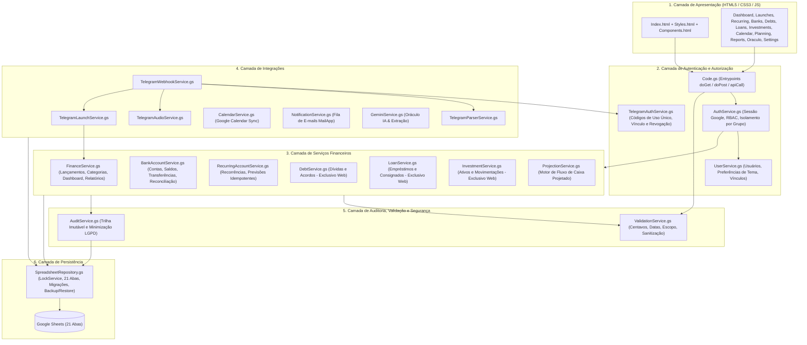

# Arquitetura do Sistema — Finanças Inteligentes

## 1. Visão Geral

O **Finanças Inteligentes** é uma plataforma web responsiva de controle financeiro pessoal e familiar construída sobre **Google Apps Script (V8)** no backend, **Google Sheets** como banco de dados relacional-tabular inicial, **HTML5 / CSS3 / JavaScript Vanilla** no frontend (`HtmlService`), integração com **Telegram Bot API** (texto e áudio), **Google Calendar API**, **MailApp** e **Gemini API** (Oráculo IA e transcrição/extração estruturada).

---

## 2. Três Decisões Arquiteturais Explícitas

1. **Telegram não é o banco de dados:**
   - O bot do Telegram atua exclusivamente como **interface de captura assistida** para propostas de lançamentos de `ENTRADA` e `SAIDA`.
   - O registro oficial somente ocorre na aba `LANCAMENTOS` do Google Sheets **após confirmação explícita do usuário** via callback autenticado e validado por hash da prévia (`preview_hash`).
   - O bot é bloqueado no nível de parser e de serviço (`TelegramParserService` e `TelegramLaunchService`) contra qualquer tentativa de criar/alterar contas recorrentes, contas bancárias, ativos ou movimentações de investimentos, dívidas, empréstimos ou configurações administrativas.

2. **Áudio exige uma etapa de transcrição e validação determinística:**
   - Mensagens de voz (`voice`, formato OGG/Opus) e arquivos de áudio (`audio`) recebidos pelo Telegram são baixados temporariamente em memória via `getFile` da Telegram Bot API, sem retenção permanente do arquivo de áudio.
   - O áudio é processado por adaptador modular (`TelegramAudioService` -> `GeminiService` multimodal ou provedor STT compatível) com instruções estritas para português brasileiro, separando milhares, centenas, dezenas e centavos (ex.: impedindo confusão entre *"quatrocentos e cinquenta"* e *"quarenta e cinco"*).
   - O resultado nunca é gravado automaticamente: passa por validação determinística (`ValidationService`), verificação de campos pendentes/ambíguos e exige confirmação explícita do usuário na prévia em reais (`R$`).

3. **Limitações de Webhook e Autenticação no Google Apps Script:**
   - **Autenticação Web App vs Webhook:** No Google Apps Script, um endpoint `doPost(e)` só é acessível externamente pela Telegram Bot API se o Web App estiver publicado com acesso `"ANYONE"` ou através de um proxy leve. Contudo, no modo `"ANYONE"`, `Session.getActiveUser().getEmail()` pode retornar vazio em contas consumidoras (`@gmail.com`) caso o usuário não esteja no mesmo domínio Google Workspace.
   - **Solução Híbrida Segura implementada (`AuthService` + `TelegramWebhookService`):**
     - **Acesso Primário Google:** `Session.getActiveUser().getEmail()` quando disponível (Workspace ou implantação `ANYONE_WITH_GOOGLE_ACCOUNT`).
     - **Token OAuth Google / Google Identity Services (GIS) validado no servidor:** Quando `Session.getActiveUser().getEmail()` vem vazio em implantação unificada, o frontend pode obter um ID Token assinado pelo Google e o backend valida criptograficamente junto ao endpoint `oauth2.googleapis.com/tokeninfo` (nunca aceitando e-mail livre ou editável pelo cliente).
     - **Validação de Segredo do Webhook Telegram:** Como o objeto `e` do `doPost(e)` no GAS não expõe cabeçalhos HTTP (`X-Telegram-Bot-Api-Secret-Token`), o webhook valida obrigatoriamente um token criptográfico em `e.parameter.secret` armazenado em `PropertiesService.getScriptProperties()` (`TELEGRAM_WEBHOOK_SECRET`), além de documentar e fornecer um script opcional gratuito de **Cloudflare Worker** que valida o cabeçalho nativo `X-Telegram-Bot-Api-Secret-Token` na borda e repassa ao GAS.

---

## 3. Arquitetura em 6 Camadas

---

## 4. Regras de Integridade Financeira

1. **Aritmética inteira em centavos:** Todos os valores monetários são armazenados e calculados como números inteiros em centavos (`valor_centavos`, ex.: `R$ 120,00` = `12000`). Nenhuma operação financeira utiliza aritmética de ponto flutuante sem conversão prévia e validação de inteiro.
2. **Separação estrita de estados:**
   - `CONFIRMADO`: Altera efetivamente o saldo realizado da conta bancária.
   - `PREVISTO`: Projeta entradas e saídas futuras, mas **nunca** é somado ao saldo bancário realizado.
   - `PENDENTE`: Aguardando pagamento/recebimento ou confirmação de conciliação.
   - `CANCELADO`: Preserva o registro histórico na base para auditoria, sem impactar saldos nem resultados.
3. **Transferências entre contas próprias:** Movimentações entre contas do mesmo grupo financeiro são registradas com natureza `TRANSFERENCIA` (gerando par vinculado de saída na conta origem e entrada na conta destino com `transferencia_id`), atualizando os saldos individuais das duas contas sem inflar o total de receitas ou despesas de consumo do mês.
4. **Isolamento de Dívidas, Empréstimos e Investimentos:**
   - Dívidas antigas ou protestadas em `DIVIDAS` não entram como despesa mensal até que haja uma negociação aprovada gerando parcelas ativas em `PARCELAS`.
   - Empréstimos consignados (`CONSIGNADO`) com desconto em folha permitem indicar se o salário cadastrado já é líquido (`desconto_em_folha_ja_deduzido = true`), evitando dupla dedução no fluxo de caixa.
   - Investimentos (`INVESTIMENTOS` e `MOVIMENTOS_INVESTIMENTOS`) compõem o Patrimônio Estimado de forma destacada do Saldo Bancário Disponível.
5. **Idempotência:** Toda gravação crítica (geração de recorrência, confirmação no Telegram, envio de notificação, sincronização de calendário) utiliza chave de idempotência (`idempotency_key`) sob bloqueio transacional (`LockService.getScriptLock()`).

